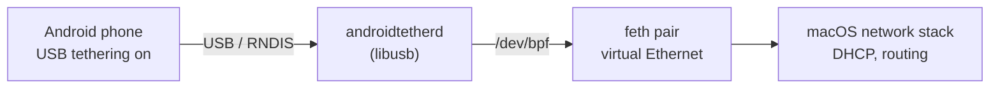

<p align="center">
  
</p>

<h1 align="center">androidtether</h1>

<p align="center"><b>Android USB tethering for Mac. No kernel extension. No app. Plug in, it works.</b></p>

<p align="center">
  <a href="LICENSE"></a>
  <a href="https://github.com/aarif2/androidtether/releases"></a>
  <a href="https://github.com/aarif2/androidtether/actions"></a>
  
  <a href="https://github.com/aarif2/androidtether/stargazers"></a>
</p>

<p align="center">
  <a href="#install">Install</a> ·
  <a href="#why">Why</a> ·
  <a href="#how-it-works">How it works</a> ·
  <a href="#compatibility">Compatibility</a> ·
  <a href="#troubleshooting">Troubleshooting</a>
</p>

---

macOS cannot talk to an Android phone in USB tethering mode. The phone speaks RNDIS, and Apple never shipped an RNDIS driver. The old fix, [HoRNDIS](https://github.com/jwise/HoRNDIS), is a kernel extension that does not work on Apple Silicon.

**androidtether** fixes that with a tiny background service. Turn on USB tethering and a network interface appears on your Mac, with an address from the phone and a working connection. Turn it off or unplug and the interface goes away. With no phone attached, it does nothing.

- **Automatic.** No window, no menu bar icon, no clicking Connect.
- **Any Android phone** that tethers over RNDIS. Plug in, no pairing.
- **Userspace.** No kernel extension, no reduced security, no SIP changes.
- **Small.** One C file, one dependency (libusb, linked statically).

## Install

```bash
brew install aarif2/tap/androidtether
sudo brew services start androidtether
```

That is all. Now plug in your phone and turn on **Settings → Network → Hotspot & tethering → USB tethering**.

Check it worked:

```bash
ifconfig | grep -A3 feth
```

You should see a `feth` interface with a `192.168.x.x` or `10.x.x.x` address.

<details>
<summary>Install without Homebrew</summary>

```bash
git clone https://github.com/aarif2/androidtether
cd androidtether
brew install libusb
make
sudo ./install.sh
```

Uninstall with `sudo ./uninstall.sh`.

</details>

## Why

If you searched for *Android USB tethering Mac*, *HoRNDIS Apple Silicon*, or *RNDIS macOS*, you have hit this wall:

- macOS has no RNDIS driver, so the phone never shows up as a network.
- HoRNDIS needs a kernel extension, which modern macOS on Apple Silicon blocks.
- Wi-Fi hotspot works but drains the phone battery.
- Bluetooth tethering stopped working on Macs from macOS 12.

androidtether talks RNDIS to the phone itself, in userspace, and hands macOS a normal virtual Ethernet interface.

## How it works



1. The service checks USB every 2 seconds for an RNDIS interface.
2. On a match it does the RNDIS handshake and reads the phone's MAC address.
3. It creates a `feth` virtual Ethernet pair and bridges frames between the phone and the pair.
4. It runs DHCP on the interface, so macOS gets an address and gateway from the phone.
5. On unplug or tethering off, it removes the interface.

## Compatibility

| Phone | macOS | Status |
| --- | --- | --- |
| Samsung (USB ID `04e8:6864`) | macOS 27, Apple Silicon | Works |
| Your phone | | [Report it](https://github.com/aarif2/androidtether/issues/new?template=phone-report.yml) |

Only RNDIS phones need this. Phones that offer CDC-NCM or CDC-ECM work on macOS natively. Intel Macs should work but are untested.

## Compared to the alternatives

| | androidtether | [HoRNDIS](https://github.com/jwise/HoRNDIS) | [TetherKit](https://github.com/XiaoMiku01/TetherKit) | Wi-Fi hotspot |
| --- | --- | --- | --- | --- |
| Works on Apple Silicon | Yes | Only with reduced security | Yes | Yes |
| Kernel extension | No | Yes | No | No |
| GUI app | No | No | Yes | No |
| Last upstream commit | Active | Feb 2023 | Jul 2026 | n/a |

## Notes

- **Interface name.** It is `fethN`, not `eth0`. macOS does not allow renaming interfaces.
- **System Settings.** The DHCP-created service is temporary and does not appear in System Settings > Network. `ifconfig` and `netstat -rn` show it.
- **Routing.** macOS decides route priority. If Wi-Fi is first in your service order it stays first, and the phone carries traffic when Wi-Fi drops.
- **Root.** The service runs as root, because creating virtual interfaces and opening `/dev/bpf` require it. The whole thing is [one file](awp_rndisd.c). Read it.

## Troubleshooting

| Problem | Fix |
| --- | --- |
| Nothing appears when I plug in | Make sure USB tethering is on, and the cable carries data (not charge-only). |
| Interface appears but no internet | Check the phone has mobile data. Run `ipconfig getifaddr feth0`. |
| Want to see what it is doing | `tail -f /var/log/androidtether.log` |
| Service not running | `sudo brew services info androidtether` |

## Uninstall

```bash
sudo brew services stop androidtether
brew uninstall androidtether
```

## Contributing

The most useful thing you can do is test your phone and [file a report](https://github.com/aarif2/androidtether/issues/new?template=phone-report.yml). See [CONTRIBUTING.md](CONTRIBUTING.md).

If it saved you a Wi-Fi hotspot, a star helps other people find it.

## License

[MIT](LICENSE)
